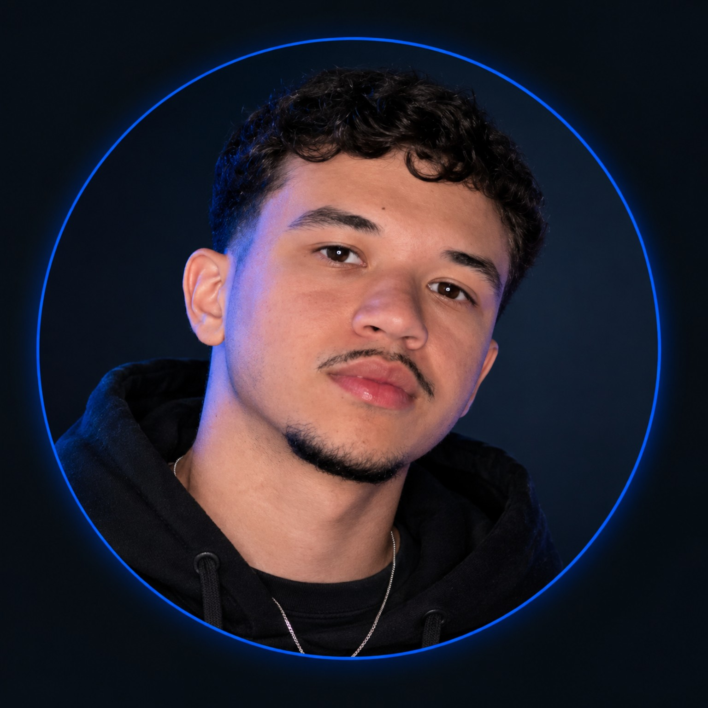
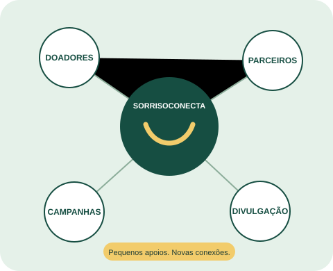

# SorrisoConecta — Sprint 1 | Front-end Design Engineering

Projeto acadêmico do Challenge Turma do Bem, FIAP, turma 1TDSPA.

**Autor:** Henrique dos Santos Ramalho — **RM:** 575759 — **Turma:** 1TDSPA.

**LinkedIn:** https://www.linkedin.com/in/henrique-ramalho-aa54752b0/

## Apresentação e proposta

O SorrisoConecta é uma proposta de plataforma para apoiar a organização de campanhas, o relacionamento com apoiadores e a priorização transparente de oportunidades de contribuição. A solução foi concebida como exercício acadêmico, sem vínculo institucional com a Turma do Bem.

## Tecnologias e escopo

HTML5 semântico e CSS3 externo; nesta sprint, o protótipo é estático, em versão desktop. Não utiliza JavaScript, servidor, banco de dados ou integração com serviços externos. O formulário de contato é visual e não envia dados. Campanhas, contatos e valores demonstrativos são fictícios.

## Organização e páginas

- `index.html`: apresentação da proposta e acesso às seções.
- `integrantes.html`: identificação, foto, RM, turma, responsabilidades e links do autor.
- `sobre.html`: contexto, solução, tecnologias e roadmap.
- `faq.html`: perguntas frequentes.
- `contato.html`: estrutura do formulário e contato do projeto.
- `campanhas.html`: exemplos de campanhas e modalidades de contribuição.
- `radar.html`: exemplo estático de oportunidades e prioridades.
- `css/style.css`: identidade visual, tipografia e componentes compartilhados.
- `imagens/`: elementos visuais e foto do integrante.

O cabeçalho e o rodapé mantêm o mesmo padrão visual nas páginas. A navegação utiliza links HTML locais. Abra `index.html` em um navegador desktop após extrair o ZIP.

## Guia técnico e informativo

**Público e objetivo:** projeto acadêmico voltado à gestão de relacionamento com doadores, parceiros e apoiadores de campanhas sociais.

**Arquitetura:** arquivos HTML na raiz do front-end, estilos em `/css` e recursos gráficos em `/imagens`; sem dependências externas.

**Navegação:** menu principal no cabeçalho, presente nas sete páginas, com links relativos para as áreas institucionais e demonstrativas.

**Identidade visual:** fundo grafite com painéis verde-escuros, acentos coral e tipografia editorial sem serifa. Componentes e navegação consistentes entre as sete páginas. A identidade utiliza CSS próprio, sem bibliotecas externas.

**Funcionalidades demonstradas:** campanhas fictícias e visualização ilustrativa de critérios para priorização de contato. Não há funcionalidade dinâmica nesta etapa.

**Limitações:** não há cadastro, armazenamento, autenticação, envio de mensagens ou pagamentos. Nenhum dado real deve ser fornecido no formulário.

**Próximos passos:** responsividade, comportamentos em JavaScript e futuras integrações são previstos na evolução do projeto.

## Repositório e visualização

GitHub do autor: https://github.com/henriqueramalho299

Repositório do projeto: https://github.com/henriqueramalho299/sorrisoconecta

Visualização pública: https://henriqueramalho299.github.io/sorrisoconecta/

A versão Dark Premium do protótipo acadêmico está publicada no GitHub Pages. O repositório público mantém o histórico de desenvolvimento do projeto.

## Pitch de apresentação — Sprint 1

Vídeo de apresentação do projeto, gravado pelo autor e compartilhado no YouTube: https://youtu.be/68RVOxgvufc

## Créditos

Conceito acadêmico elaborado para o Challenge da FIAP com base no desafio da Turma do Bem. Elementos visuais locais e conteúdo demonstrativo; dados de exemplo fictícios.

## Identidade visual

A interface utiliza fundo grafite, cartões em verde profundo, detalhes coral e tipografia de alto contraste. Interações decorativas são feitas exclusivamente em CSS, sem JavaScript.