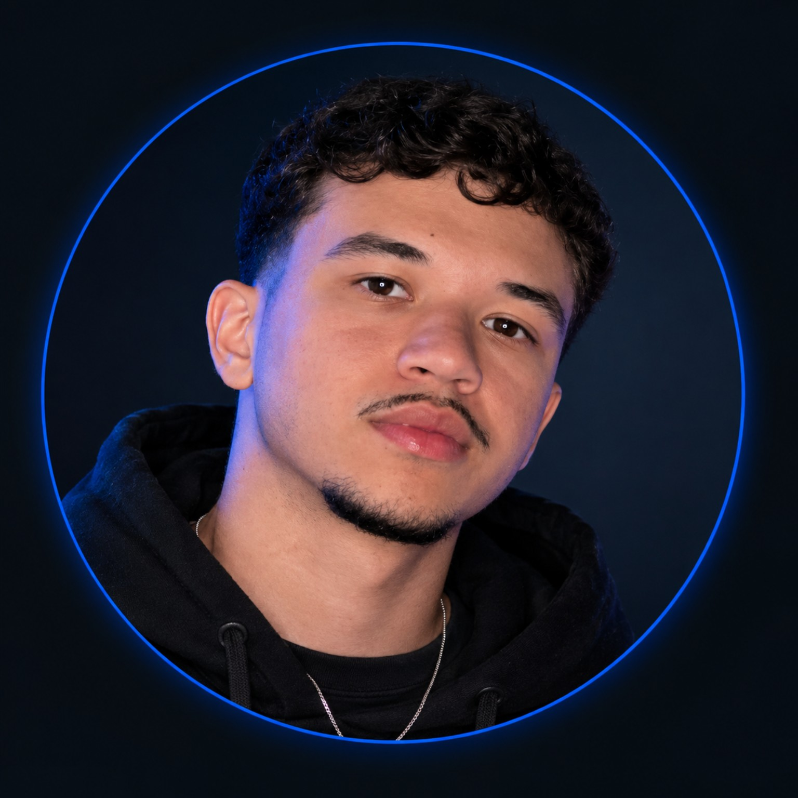
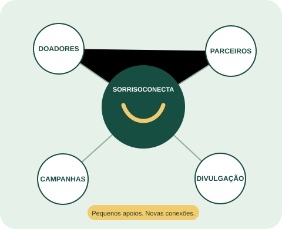

# SorrisoConecta

**Cada apoio encontra um caminho para fazer o bem.**

Protótipo acadêmico do Challenge Turma do Bem, FIAP, Sprint 1. O projeto organiza apoiadores, campanhas locais e o histórico de relacionamento. O Radar de Apoio demonstra uma prioridade explicável com interesse, compatibilidade e tempo sem contato.

## Tecnologias

HTML5 e CSS3 escritos para este projeto. Não há JavaScript, frameworks, fontes remotas, bibliotecas externas ou conexão com servidor. Os SVGs foram desenhados para a proposta. Fonte de sistema: Arial/sans-serif.

## Como abrir

Extraia a pasta e abra `index.html` no navegador. Os links são relativos e funcionam sem instalação. Use uma janela desktop com largura de 992 pixels ou mais. O CSS tem ajustes para 992px e 1300px. A versão inclui adaptações simples para telas menores; a avaliação desta sprint é desktop.

## Páginas

- `index.html`: apresentação e caminho de apoio.
- `integrantes.html`: identificação do integrante e responsabilidades.
- `sobre.html`: problema, proposta, tecnologias e roadmap.
- `faq.html`: dúvidas frequentes, usando details/summary do HTML.
- `contato.html`: formulário demonstrativo com labels e validação nativa.
- `campanhas.html`: três campanhas fictícias e modalidades de apoio.
- `radar.html`: classificação explicável e próxima ação da equipe.
- `css/style.css`: identidade e componentes compartilhados.
- `imagens/`: símbolo, rede de apoio e foto real do integrante.

## Autor

Henrique dos Santos Ramalho · RM 575759 · 1TDSPA · FIAP.

GitHub: https://github.com/henriqueramalho299

LinkedIn: https://www.linkedin.com/in/henrique-ramalho-aa54752b0/

Foto: `imagens/henrique.png`.

## Identidade e imagens

As imagens SVG são locais e não representam a marca oficial da Turma do Bem. Os nomes, números e campanhas da demonstração são fictícios.

## Repositório e visualização pública

Repositório GitHub: https://github.com/henriqueramalho299/sorrisoconecta

GitHub Pages: https://henriqueramalho299.github.io/sorrisoconecta/

O histórico local foi preparado em commits reais de construção do front-end, com autoria de preparação identificada como SorrisoConecta. O arquivo `historico_frontend.bundle`, entregue no material de apoio, permite recuperar esse histórico. Seus próximos commits devem usar sua configuração pessoal. Não inventar contribuições de integrantes.

## Contato

Contato do autor pelo perfil GitHub informado acima. O formulário `contato.html` é uma demonstração, não uma caixa de mensagens. Ele usa validação nativa do navegador e retorna à mesma página; não envia nem armazena os dados. Use somente exemplos fictícios.

## Escopo e validação

O site não coleta dinheiro, não seleciona beneficiários e não automatiza contato nesta sprint. Os exemplos do radar são consistentes com os dados iniciais do Python. A autorização para contato é uma regra do protótipo e não representa uma certificação de conformidade legal.

Foi feita verificação estrutural dos HTMLs, dos links locais e dos arquivos CSS e SVG. O autor conferiu e publicou a versão anterior. O novo visual precisa ser conferido no navegador após substituir os arquivos e antes da entrega. Foto e LinkedIn já foram incluídos.

Crédito do contexto: enunciado FIAP, “1TDS Agosto - TDB - Sprint 1 e 2_v3”. Implementação e ilustrações preparadas com apoio de IA, para revisão e compreensão pelo aluno.

## Direção visual

Redesenho com fundo escuro, detalhes coral, tipografia ampla e rede de apoio animada em CSS. A referência de composição foi https://www.cognichip.ai/, com ilustração e conteúdo próprios do SorrisoConecta. Não foram usados código ou imagens da referência.

As transições, rolagem suave e movimentos decorativos usam apenas CSS. A preferência de movimento reduzido desativa os efeitos. Nenhum JavaScript foi incluído.
